# Sprite Studio

**Turn a text description into an animated, transparent game sprite — idle, walk, attack, spells and all.**

You type what your character looks like. The studio draws it, animates it with an AI video model, then
cleans it up into real pixel-art sprite frames you can drop straight into a game (Godot export included).

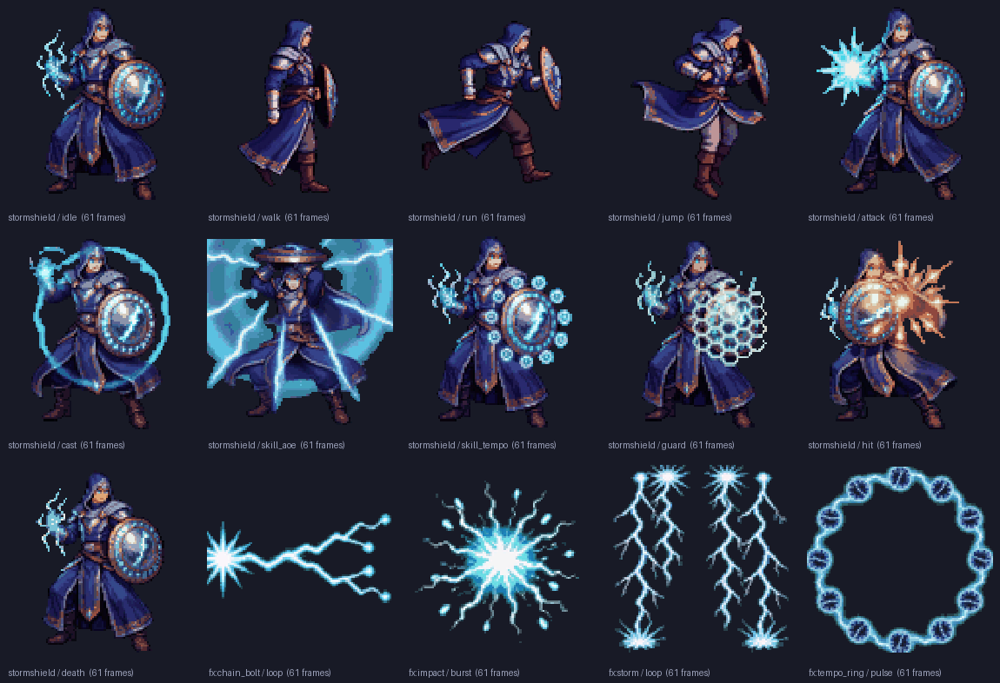

*Everything above came out of this tool: one character with 11 animations, plus 4 spell effects.*

## Examples

Every one of these started as a paragraph of text. No drawing, no animating by hand.

<table>
<tr><td align="center">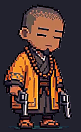<br><sub>Monk · idle</sub></td><td align="center">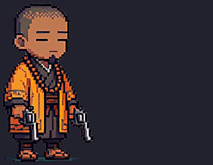<br><sub>Monk · attack</sub></td><td align="center">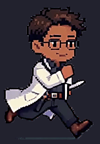<br><sub>Surgeon · run</sub></td><td align="center">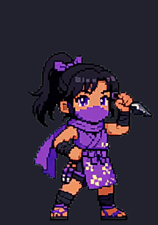<br><sub>Ninja · leap</sub></td><td align="center">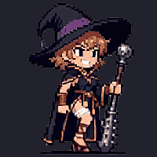<br><sub>Sorcerer · walk</sub></td></tr>
<tr><td align="center">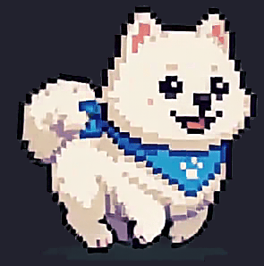<br><sub>Dog · run</sub></td><td align="center">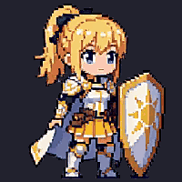<br><sub>Paladin · idle</sub></td><td align="center">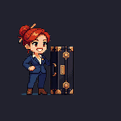<br><sub>Businesswoman · attack</sub></td><td align="center">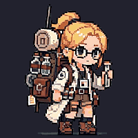<br><sub>Scientist · idle</sub></td><td align="center">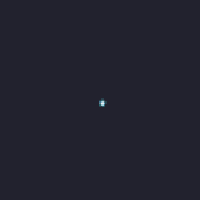<br><sub>Effect · impact burst</sub></td></tr>
</table>

*(The previews have a dark background so you can see them. The real frames are transparent PNGs.)*

---

## Before you start: what you need

Read this list first. If you're missing any of these, the studio **will not work**.

| You need | Why | How to check |
|---|---|---|
| **Windows PC with an NVIDIA GPU, 16 GB VRAM or more** | The AI models run on your graphics card | Task Manager → Performance → GPU → "Dedicated GPU memory" |
| **[ComfyUI](https://github.com/comfyanonymous/ComfyUI)** installed and working | It's the engine that actually runs the AI models. This studio just tells it what to do. | You can open ComfyUI in your browser and generate an image |
| **Python 3.9 or newer** | Runs the studio | Open Command Prompt, type `python --version`, press Enter. You should see `Python 3.9` or higher. |
| **The AI model files** (list below) | Without them ComfyUI has nothing to run | Look in your ComfyUI `models` folder |

### The model files

Put each file in the ComfyUI folder shown. **The file names must match exactly** — don't rename them.
Search each file name on [Hugging Face](https://huggingface.co) to find and download it.

| File | Goes in `ComfyUI/models/...` | Used for |
|---|---|---|
| `krea2_turbo_fp8_scaled.safetensors` | `diffusion_models/` | Drawing the character |
| `qwen3vl_4b_fp8_scaled.safetensors` | `text_encoders/` | Drawing the character |
| `qwen_image_vae.safetensors` | `vae/` | Drawing the character |
| `minimax_h3_ref2va_pruned_int8_convrot.safetensors` | `diffusion_models/` | Animating |
| `qwen3vl_32b_minimax_h3_nvfp4_awq.safetensors` | `text_encoders/` | Animating |
| `minimax_h3_video_vae_fp16.safetensors` | `vae/` | Animating |
| `minimax_h3_audio_vae_fp32.safetensors` | `vae/` | Animating |
| `minimax_h3_ref2v_turbo_4step_v0.1_comfyui_bf16.safetensors` | `loras/` | Animating (fast mode) |

*Optional, only for the image-edit feature:* `qwen_image_edit_2509_fp8_e4m3fn.safetensors` (`diffusion_models/`),
`Qwen-Image-Edit-2509-Lightning-4steps-V1.0-bf16.safetensors` (`loras/`), `qwen_2.5_vl_7b_fp8_scaled.safetensors` (`text_encoders/`).

After adding model files, **restart ComfyUI** so it sees them.

---

## Install (one time only)

### Step 1 — Download this project

**Easy way:** at the top of this GitHub page, click the green **`<> Code`** button → **Download ZIP**.
Unzip it somewhere simple, like `C:\SpriteStudio`.

**Or with git:**

```bash
git clone https://github.com/mdisada/sprite-studio.git
```

### Step 2 — Install the Python bits

1. Open the folder you just unzipped (the one that has `studio.bat` in it).
2. Click the address bar at the top of the File Explorer window, type `cmd`, press **Enter**.
   A black Command Prompt window opens, already in the right folder.
3. Copy this line, paste it into that window, press **Enter**:

```bash
pip install -r requirements.txt
```

Wait until it finishes and you see the prompt again. That's it — you never have to do this again.

> **"pip is not recognized"?** Python isn't installed correctly. Reinstall Python from
> [python.org](https://www.python.org/downloads/) and **tick "Add Python to PATH"** on the first installer screen.

---

## Every time you use it

1. **Start ComfyUI first** and leave it running. (The studio finds it automatically.)
2. **Double-click `studio.bat`.**
3. Your browser opens **http://127.0.0.1:8899** — that's the studio.
   If it doesn't open by itself, type that address into your browser.
4. **Leave the black window open** while you work. Closing it closes the studio.

---

## Making your first sprite

The studio walks you through 3 steps for each sprite. Follow them in order.

### 1. Make a reference picture (~1 minute)

- Click **+ New character** (a person, creature, animal...) or **+ New effect** (a spell, explosion, aura...).
- A ready-made description appears. **Only replace the parts in CAPITALS that start with `DESCRIBE`.**
  Leave the rest alone; it's what makes the background transparent and keeps the style consistent.
- Generate the reference. Don't like it? Click **🎲 6 seed variations** to get 6 more takes and pick the best.
  Pictures are cheap, so try as many as you want.
- Already have art? Use **📤 upload a reference image** instead.
- When you're happy, click **✓ approve this reference**.

### 2. Animate it (~10 minutes per animation)

- Pick animations from the presets: idle, walk, run, jump, attack, skill, hit, death, victory...
  (**+full kit** adds the whole standard set in one click.)
- Each animation has a short **action** sentence describing the movement. The preset fills it in; tweak it if you like.
- Before anything starts, a box pops up telling you **exactly what will render and how long it will take**. Read it, then confirm.
- Use **test** renders first if you're unsure — they're quick but rough. Switch to final for the real thing.
- This part is slow. Queue several animations at once and go do something else.

### 3. Tweak the result (instant, free)

- Adjust sprite size, colors, speed, and trim frames off the start/end.
- These changes take seconds and **don't re-run the AI**, so experiment freely.
- Click **Export for Godot** when you're done (see below).

---

## Sample: writing a good description

This is the kind of thing you write in the `DESCRIBE` parts. Be specific about **who they are, their body, face, outfit, colors, and what they're holding**.

**Character** (this made the dog in the examples):

> A single chibi fluffy white Samoyed dog stands happily on all four legs ... large round friendly black eyes,
> an open mouth smiling with a small pink tongue out ...

**Character** (this made the monk):

> A single chibi monk man with his eyes drawn shut ... stands in a still centered stance with a long-barrelled
> revolver held low in each hand ... A bald head with a row of small dark incense dots across the crown, a thin
> dark goatee, and dark brown skin. He wears layered bright orange monk robes with a dark brown sash ...
> and a long string of large wooden prayer beads hangs around his neck. Bright orange, dark brown, grey and gunmetal colors.

**Effect** (this made the impact burst):

> A radial electric impact burst: a bright cyan-white flash core with jagged lightning sparks radiating outward
> in all directions and a few small floating embers, centered.

**Animation action** (the monk's attack):

> He begins in his ready stance, then SHOOTS BOTH PISTOLS IN RAPID SUCCESSION, the pistols kicking sharply upward
> in under half a second, then lowers the arms, bows his head briefly, and settles into the exact ready stance he
> started in and holds it.

**Tips that make a big difference**

- ✅ **Start and end the action in the same pose** ("settles into the exact ready stance he started in").
  That makes the animation loop smoothly in your game.
- ✅ **Write the key move in CAPITALS** so the video model doesn't skip it.
- ✅ **List colors at the end** ("Bright orange, dark brown, grey"). The model sticks to them better.
- ❌ **Don't describe a background or scenery.** The template already asks for a green screen, and anything else breaks transparency.
- ❌ **Don't put huge effects on a character** (giant explosions, long beams). Make those a separate **+ New effect** sprite
  and layer it on top in your game. Otherwise they get cut off at the edge of the frame.

### Where are my sprites?

In the `sprites_out` folder, one folder per sprite:

```
sprites_out/<your sprite>/
  ref.png              the reference picture
  idle/
    frames/            each frame as a transparent PNG   ← use these in your game
    sheet.png          all frames in one sprite sheet     ← or this
    preview.gif        quick preview
    meta.json          frame size, fps, grid layout
```

### Using them in Godot

Click **Export for Godot** in the studio, or run this in the Command Prompt:

```bash
python -m sprite_pipeline.export_godot --char YOUR_SPRITE_NAME
```

This creates `sprites_out/_export/YOUR_SPRITE_NAME.zip` with a sprite sheet and ready-made Godot 4 animation
resources. All animations share one size and anchor, so your character doesn't jump around when switching from idle to attack.

---

## Something's wrong?

| Problem | Fix |
|---|---|
| Studio says **ComfyUI not reachable** | ComfyUI isn't running. Start it, wait until it's fully loaded, then refresh the studio page. |
| `studio.bat` flashes and closes / says **No module named ...** | You skipped Step 2 of the install. Do it now. |
| **'python' is not recognized** | Install Python from [python.org](https://www.python.org/downloads/) and tick **"Add Python to PATH"**. |
| ComfyUI errors about a **missing model / value not in list** | A model file is missing, in the wrong folder, or renamed. Check the table above, then restart ComfyUI. |
| **Out of memory** errors | Close other programs using the GPU (games, other AI tools). You need 16 GB VRAM. |
| Background isn't transparent / green edges | You edited out the green-screen part of the description. Click **+ New character** again to get a fresh template and only change the `DESCRIBE` part. |
| Port 8899 is already in use | Another studio is already open — check your other browser tabs and black windows. |
| Results look rough in **test** mode | Test mode is a quick plumbing check, not quality. Use **final** mode for real sprites. |

### Optional settings

You almost never need these. To use one, open `studio.bat` in Notepad and add the line **above** the `python` line:

| Setting | Example line | When you'd need it |
|---|---|---|
| ComfyUI address | `set COMFY_HOST=127.0.0.1:8188` | ComfyUI runs on another computer or an unusual port |
| ComfyUI output folder | `set COMFY_OUTPUT_DIR=C:\ComfyUI\output` | Makes downloads faster. Not required — it works without it. |
| Studio port | `set SPRITE_UI_PORT=9000` | Something else already uses port 8899 |

---

## For power users

<details>
<summary><b>Command-line usage</b> (no browser needed)</summary>

```bash
# fast smoke test (512px ref, 384px 22-frame clip, 4-step turbo)
python -m sprite_pipeline.pipeline --char stormshield --mode test --stage all --anim idle

# quality run, several animations
python -m sprite_pipeline.pipeline --char stormshield --mode final --stage all --anim idle cast walk

# stages run separately; post can be re-run/tuned without regenerating
python -m sprite_pipeline.pipeline --char stormshield --stage post --anim idle --take-every 2 --trim-start 4

# export everything in a project for Godot
python -m sprite_pipeline.export_godot --project heroes --height 128

# bake a project into one self-contained HTML playground (no server needed)
python -m sprite_pipeline.pack_playground --project heroes --out playground.html
```

Sprite definitions live in `characters.json`, shared by the web UI and the CLI.

</details>

<details>
<summary><b>How the pipeline works</b></summary>

1. **ref** — Krea-2 Turbo (8-step text-to-image) draws the character on a flat `#00FF00` green screen in pixel-art style.
2. **anim** — MiniMax H3 reference-to-video animates that exact character, using the 4-step turbo LoRA for speed.
   Frames are saved as lossless PNGs plus an mp4 preview.
3. **post** — pure Python (PIL/numpy): keys out the green screen with despill, crops to a stable bounding box,
   downscales to sprite resolution, locks every frame to one shared palette (no color flicker), and writes
   frames, a sprite sheet, a GIF, a transparent APNG and `meta.json`.

Design notes:

- **Model loading**: stages are grouped per model family and ComfyUI's `/free` is called between them, so a 16 GB GPU never holds both models at once.
- **H3 clip length** must be `5 + 17k` frames at 24 fps. The trained range is ~124–362 frames (5.2s+); test mode's 22-frame clips are only for plumbing checks.
- **Green screen instead of transparency**: diffusion models can't output alpha, so we prompt a flat green backdrop and key it out.
- **Palette lock**: one median-cut palette is built from all frames of an animation and every frame is quantized to it — this is what makes it read as hand-pixelled animation instead of smeared video.

</details>

<details>
<summary><b>Workflow tips for big batches</b></summary>

Loading a model costs time, so batch by model:

1. Make **all reference pictures first** (~1 min each). Re-roll until each is right.
2. Queue **all animations in one go** (~10 min each in final mode).
3. Post-process and tune last — it's free and takes seconds.

**Effects (VFX)** are separate sprites you layer on top of characters in your game engine, usually with additive blending.
Keep the whole effect inside the frame with every end visible; only cut at the edge for beams meant to tile seamlessly.

</details>
